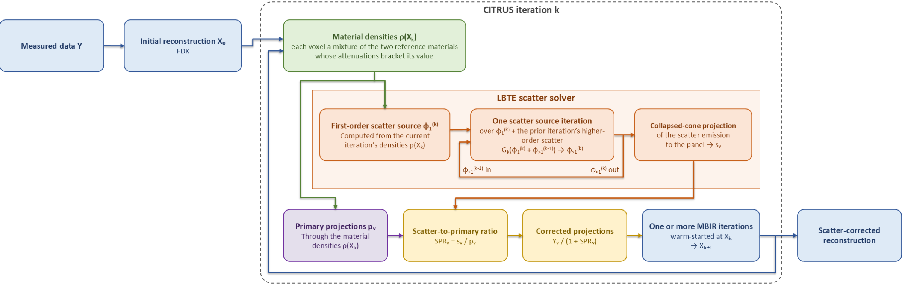

CITRUS: scatter-corrected MBIR for cone-beam CT
===============================================

**Reconstruct cone-beam CT volumes from scatter-contaminated projections with a photon transport solver running
inside the reconstruction loop.**

Scatter is the largest source of shading, cupping and wrong CT numbers in cone-beam CT. The usual remedy estimates
the scatter once, from a first reconstruction that is itself corrupted by scatter, and never revisits it. CITRUS
(Coupled Iterative Tomographic reconstruction and Recursively-Updated Scatter) instead pairs every iteration of
model-based iterative reconstruction (MBIR) with one step of a deterministic solver of the linear Boltzmann transport
equation (LBTE). The scatter estimate and the reconstruction converge together, for the cost of one transport sweep
per view per iteration.

A reconstruction in a few lines
-------------------------------

.. code-block:: python

   from citrus import CitrusConfig, citrus_recon
   from citrus.utilities import wlab_solver

   solver = wlab_solver(delta_voxel, geometry=geometry)   # LBTE solver with the cached cross-section library
   recon, info = citrus_recon(counts, flat_field, angles, grid, geometry, solver,
                              CitrusConfig(num_outer=80, scatter_every=8, scatter_view_stride=8))

``counts`` are the measured projections (primary plus scatter), ``grid`` and ``geometry`` describe the volume and the
cone-beam scanner in MBIRTORCH's conventions, and the configuration sets how often the scatter is refreshed.
:doc:`usage` walks through the demo that produces the figures below.

What CITRUS gives you
---------------------

.. grid:: 1 2 2 2
   :gutter: 3

   .. grid-item-card:: Scatter and reconstruction converge together

      The per-view collided fluence is carried from one outer iteration to the next and refreshed by one transport
      sweep per iteration. With the volume held fixed the recursion *is* source iteration, so the scatter estimate is
      the converged one when the reconstruction has converged.

   .. grid-item-card:: A deterministic photon transport solver

      Multigroup in energy, discrete ordinates in angle, linear-discontinuous finite elements in space, Compton and
      Rayleigh cross sections from EPDL97, first-collision source exact in energy, collapsed-cone projection to the
      detector with the anti-scatter grid and detector responses.

   .. grid-item-card:: Independent of the reconstruction grid

      The transport runs on cells of a chosen size (1 cm by default) with a few quadrature points per cell, so a
      0.5 mm reconstruction costs the solver the same as a 5 mm one. Any voxel-to-cell ratio works.

   .. grid-item-card:: Fast on one GPU

      Fused Triton kernels for the ray tracer, the first-collision source and the sweep. On the synthetic study
      (180 views, 0.5 cm voxels) the scatter step costs about 0.3 s per view, and the demo reconstruction with ten
      scatter stages runs in under four minutes on a laptop-class GPU.

How it works
------------

         material densities, the LBTE scatter solver (first-order scatter source, one scatter source iteration over
         it plus the prior iteration's higher-order scatter, collapsed-cone projection), the primary projections,
         the scatter-to-primary ratio, the corrected projections and one or more MBIR iterations, looping back.

   The CITRUS algorithm. Every iteration converts the current reconstruction into material densities, advances each
   view's higher-order scatter by one scatter source iteration over the new first-order source and the prior
   iteration's higher-order scatter, divides the measured data by one plus the scatter-to-primary ratio and runs one
   or more warm-started MBIR iterations on the result.

Each outer iteration :math:`k` turns the reconstruction :math:`X_k` into densities of the anchor materials, resamples
them onto the transport cells, and updates the per-view collided fluence :math:`\Phi_v` with one transport sweep
:math:`G_k` applied to the newest first-collision term :math:`\phi_1` and to the previous accumulator:

.. math::

   \Phi_v^{(k)} = G_k\,\phi_1^{(k)} + G_k\,\Phi_v^{(k-1)}
                = G_k\,\phi_1^{(k)} + G_k G_{k-1}\,\phi_1^{(k-1)} + G_k G_{k-1} G_{k-2}\,\phi_1^{(k-2)} + \dots

The second-order scatter always comes from the newest reconstruction, the third order from the previous one, and so
on: the dominant low orders are refreshed first while stale information is pushed into the weak, smooth high orders.
The projected scatter :math:`s_v` and the primary :math:`p_v` of the current volume give the correction
:math:`Y_v / (1 + s_v / p_v)`, which is independent of the flat field and of any mismatch between the solver's
polychromatic model and MBIR's monoenergetic one. :doc:`method` has the derivation and :doc:`design_notes` the
measurements behind each choice.

On the synthetic water-lung-air-bone study (180 views over a short scan, 0.5 cm voxels, scatter-to-primary ratios up
to 24) the uncorrected MBIR reconstruction has a relative RMSE of 0.29 and FDK 0.32; CITRUS reaches 0.022 with ten
scatter stages. :doc:`results` has the full tables.

Built on MBIRTORCH and XrayPhysics
----------------------------------

The reconstruction side is `MBIRTORCH <https://github.com/cabouman/mbirtorch>`_: its cone-beam model provides the
forward projections, the FDK initialization and the vectorized coordinate descent iterations, warm-started and resumed
from their error sinogram between scatter updates. The photon interaction data come from
`XrayPhysics <https://github.com/kylechampley/XrayPhysics>`_ (EPDL97), from which the multigroup cross-section
library of the chosen anchor materials is built once and cached.

Documentation
-------------

.. grid:: 1 3 3 3
   :gutter: 3

   .. grid-item-card:: Getting started
      :link: installation
      :link-type: doc

      Installation, the two demos and the options of the reconstruction loop.

   .. grid-item-card:: User guide
      :link: method
      :link-type: doc

      The method, the conventions of grids, units and materials, the design decisions with their measurements, and
      the results of the synthetic study.

   .. grid-item-card:: Reference
      :link: api
      :link-type: doc

      The API of the reconstruction loop, the scatter solver and the MBIRTORCH bridge; how to cite the package.

.. toctree::
   :maxdepth: 2
   :hidden:
   :caption: Getting started

   overview
   installation
   usage

.. toctree::
   :maxdepth: 2
   :hidden:
   :caption: User guide

   method
   conventions
   design_notes
   results

.. toctree::
   :maxdepth: 2
   :hidden:
   :caption: Reference

   api
   citation
